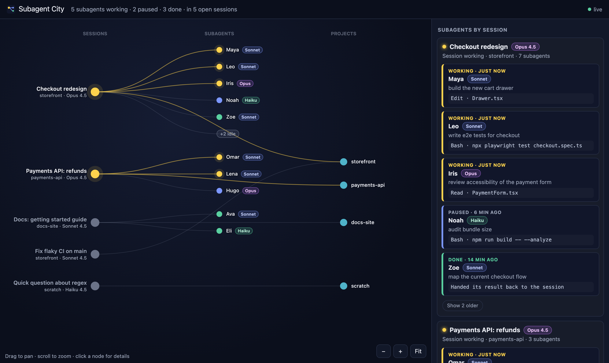
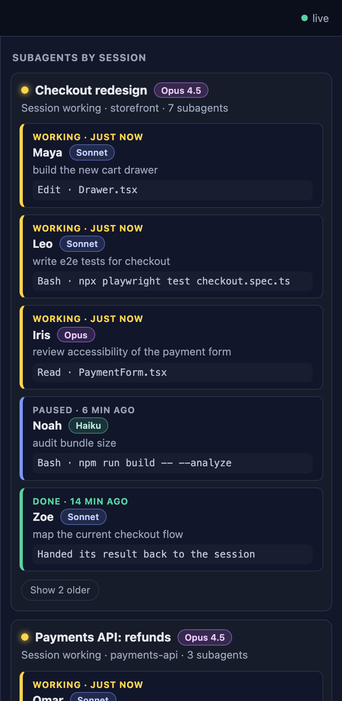

<div align="center">


# Subagent City

**See every Claude Code subagent running on your machine, live.**

Who started it, what it is doing right now, which model it runs on, and when it is done.


</div>



<sub>Screenshot from `npm run demo`, which uses made-up sessions.</sub>

---

## Why

Once you hand work to subagents, the terminal stops telling you much. You see "running…", and five subagents are reading, editing, testing and finishing at once in sessions you can't all keep on screen.

Subagent City turns that into one picture you can glance at.

## What you see

<table>
<tr>
<td width="55%" valign="top">

**🗺️ A live map**

Sessions on the left, the subagents each one started in the middle, and the projects they touch on the right. Busy sessions float to the top, and active links pulse.

**🃏 A card for every subagent**

Each card shows the subagent's name, its task and its model badge. It also shows its **last step**, the tool it just called (`Bash · npm test`, `Edit · Drawer.tsx`) or its last words.

**🚦 Four states at a glance**

- 🟡 **Working**: wrote to its transcript in the last 90 seconds.
- 🔵 **Paused**: active within the hour.
- 🟢 **Done**: handed its result back to the session.
- ⚪ **Idle**: older. Idle subagents fold into one "+N idle" node until you open them.

**🧠 Models**

Opus, Sonnet and Haiku each get their own colour, for sessions and subagents alike.

</td>
<td width="45%" valign="top">



</td>
</tr>
</table>

It refreshes every few seconds, pauses while the tab is hidden, and turns its "live" dot red if it loses the server.

## Quick start

You need Node.js 20 or later.

```bash
git clone https://github.com/gustavos00/subagent-city.git
cd subagent-city
npm install
npm run build
npm start
```

Open **<http://localhost:4777/>**, then start a Claude Code session that uses subagents. It shows up within a few seconds.

Use `npm start -- --port 5000` (or `SUBAGENT_CITY_PORT=5000`) to run it on another port.

### Just want to look?

```bash
npm install
npm run build
npm run demo
```

This serves a made-up set of sessions and subagents on <http://localhost:4778/>, with no Claude Code needed.

## Name your subagents

Subagent City reads each subagent's name from its description. When you (or Claude) start a subagent with a description like:

```text
Ana: review the checkout form
```

it shows up as **Ana**, with "review the checkout form" as its task. Names make a crowded map much easier to read.

## How it works

```text
~/.claude/sessions/<pid>.json        ──►  which sessions are open (one file per running Claude Code process)
~/.claude/projects/…/<session>.jsonl  ──►  the session's model
~/.claude/projects/…/<session>/subagents/*.jsonl + .meta.json
                                     ──►  each subagent: name, task, model, last step, state
```

A small Node server reads these files and serves `/api/sessions` and the page.

- **A session counts as open only while its process is alive.**
- **It reads as little as it can.** It reads only the start and end of each transcript, and caches every file by its modification time, so a quiet subagent costs nothing.

> **Heads-up:** these are Claude Code's own files, not a public API, so a Claude Code update can change them. Every field is parsed defensively: a missing one leaves a blank, never a crash. Set `SUBAGENT_CITY_CLAUDE_DIR` if your Claude folder lives somewhere else.

## Privacy and safety

- 🔒 **It runs entirely on your machine.** Nothing is sent anywhere, and there is no telemetry.
- 🏠 **It listens on `127.0.0.1` only.** It also rejects requests addressed to any other host name, so other web pages can't read it through DNS rebinding.
- 👀 **It is read-only.** It accepts only GET and HEAD requests, and never starts, stops or changes a session.
- 🛡️ **A strict Content Security Policy** applies: no inline scripts and no third-party requests.
- 📸 **Check before you share a screenshot.** The page shows session titles, folder names, subagent tasks and the last command each one ran.

## Development

```bash
npm install
npm run dev        # server on :4777 with reload, and the Vite page on :5173 (proxies /api)
npm test           # Vitest: server and web
npm run lint       # ESLint, zero warnings allowed
npm run typecheck
npm run build      # builds the page, then the server, and bundles the page into it
```

The repository is an npm workspaces monorepo:

| Package                              | What it is                                                                                                         |
| ------------------------------------ | ------------------------------------------------------------------------------------------------------------------ |
| [`packages/server`](packages/server) | The `subagent-city` CLI: reads `~/.claude` and serves the API and the page. TypeScript, no runtime dependencies.   |
| [`packages/web`](packages/web)       | The page: React 19, Tailwind CSS 4 and Vite. The map is drawn on a canvas, so it stays smooth with many subagents. |
| [`packages/shared`](packages/shared) | The types of the `/api/sessions` contract, shared by both.                                                         |

The code is TypeScript in strict mode and is checked by ESLint with `typescript-eslint` strict rules, React, hooks, accessibility and Testing Library rules.

## Scope of v1

- ✅ Claude Code sessions and their subagents, on the machine the server runs on.
- ✅ Read-only.
- 💭 Ideas for later: other agent tools, several machines, and history of finished runs.

Issues and pull requests are welcome.

## License

[MIT](LICENSE) © Gustavo Santos
